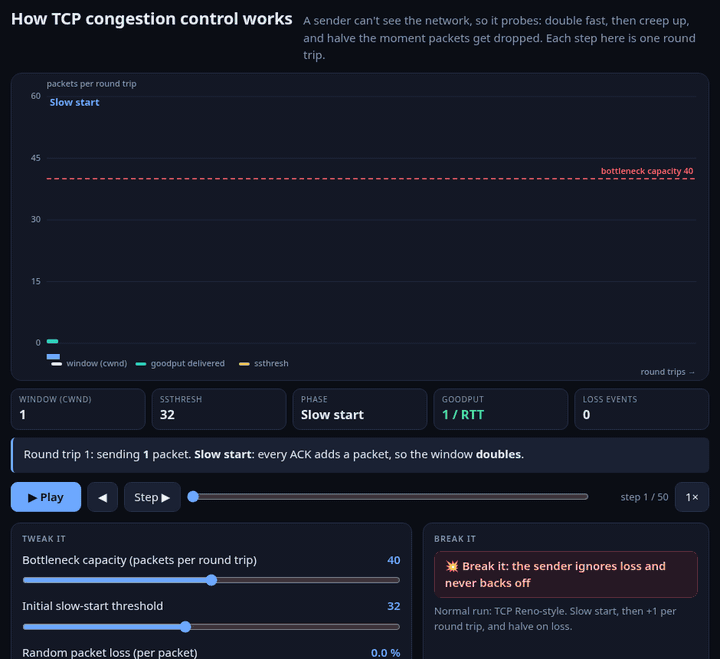
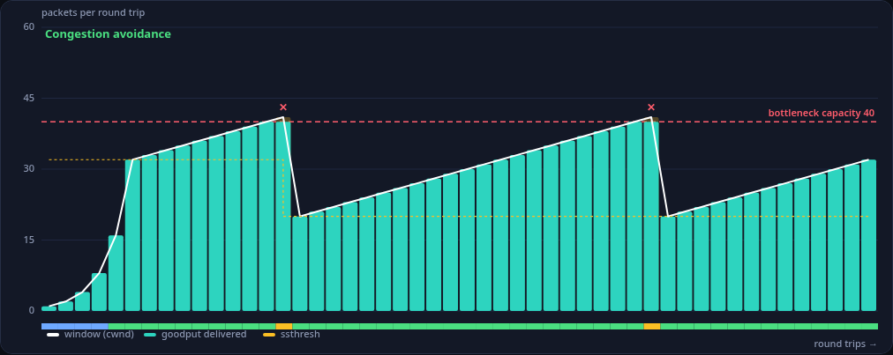
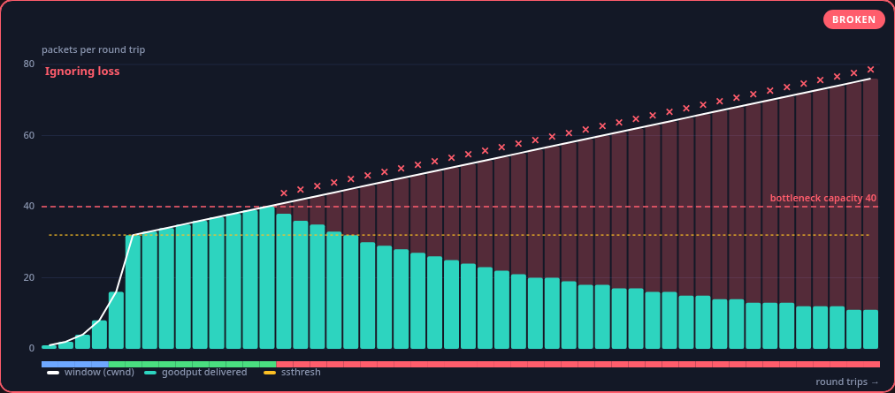
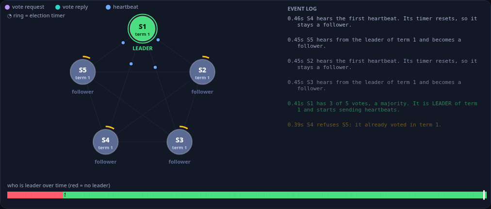
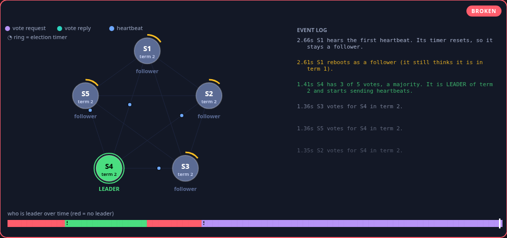

<h1 align="center">tinkertoy</h1>

<p align="center"><b>Ask your coding agent how something works. Get a toy you can play with.</b><br>
One self-contained HTML file: live sliders, a scrub bar, and a <i>Break it</i> button.</p>

<p align="center"></p>

<p align="center"><a href="https://barood-labs.github.io/tinkertoy/"><b>Open the gallery →</b></a> (live demos, no install)</p>

---

Most "how does X work?" answers are three paragraphs and a diagram you have to imagine in motion.
**tinkertoy** is an agent skill that makes your coding agent build the thing instead: a single `.html` file, no server, no network, no dependencies. You change the inputs, scrub through time, and press **Break it** to see what actually goes wrong when the key mechanism fails.

## Install

```bash
npx @barood-labs/tinkertoy init
```

That copies the skill into `.claude/skills/tinkertoy` (Claude Code) and `.agents/skills/tinkertoy` (Codex and Cursor), and adds a short marked block to `AGENTS.md`. Re-running it updates in place.

Then just ask:

> How does a Raft leader election work?

and the agent writes `tinkertoys/raft-leader-election.html`. Double-click it.

| Agent | Where the skill goes | Flag |
| --- | --- | --- |
| Claude Code | `.claude/skills/tinkertoy/` | default |
| Codex, Cursor | `.agents/skills/tinkertoy/` | default |
| Cursor (its own folder) | `.cursor/skills/tinkertoy/` | `--cursor` |

Other options: `--only claude,agents`, `--global` (your home directory), `--dir <path>`, `--no-agents-md`, `--dry-run`.

## What a tinkertoy has

Every output follows the same rules (see [`skill/SKILL.md`](skill/SKILL.md) and [`skill/CHECKLIST.md`](skill/CHECKLIST.md)):

- **One file, fully offline.** No CDN, no fonts, no fetch, no `<script src>`. Works from `file://`.
- **2 to 5 sliders** that change the behaviour, each with a plain-English label and units.
- **A step / play / scrub timeline.** Every frame carries a caption saying what happened and why.
- **A "Break it" button** that switches on a real failure mode (never resize, ignore packet loss, skip the certificate check, forget a root, crash the leader) and visibly changes the picture and the numbers.
- **A clear visual**, drawn on a canvas, plus a "what to notice" list.
- **Deterministic.** Seeded randomness, no `Math.random`, no clock, so the same sliders always give the same run (and it can be tested).
- **Phone-friendly, keyboard-friendly, reduced-motion aware.**

## Check an output

```bash
npx @barood-labs/tinkertoy validate tinkertoys/my-sim.html
npx @barood-labs/tinkertoy validate tinkertoys/*.html --run --strict
```

The validator is zero-dependency. It errors on the hard rules (external resources, missing sliders, missing break button, `Math.random`, no timeline) and warns on soft ones. `--run` also loads the file in headless Chrome (needs `playwright-core`), moves the sliders, presses Break it and fails on any console error. The skill tells the agent to run it before handing the file back.

## The examples

Six working sims, each one a single HTML file in [`examples/`](examples/):

| Example | Break it |
| --- | --- |
| [How a hash table grows](examples/hashtable.html) | never resize, so chains keep growing |
| [How TCP congestion control works](examples/tcp.html) | the sender ignores loss and never backs off |
| [How a Raft leader election works](examples/raft.html) | crash the leader and watch a new election |
| [How an HTTPS (TLS) handshake works](examples/tls.html) | skip certificate checks, so an attacker in the middle gets in |
| [How garbage collection (mark and sweep) works](examples/gc.html) | the collector forgets a root, so live objects get freed |
| [Git merge vs rebase](examples/git.html) | both sides edit the same lines, so you get a conflict |

Models are simplified on purpose: the TLS one uses tiny numbers, the TCP one counts rounds rather than bytes. They show the *shape* of the behaviour, not a production implementation.

| Normal | Broken |
| --- | --- |
|  |  |
|  |  |

(More screenshots, including mobile ones, are in [`docs/shots/`](docs/shots/).)

## How it works

```
skill/SKILL.md        what the agent reads: when to use it, the rules, the API
skill/template.html   the starting point the agent copies and edits
skill/CHECKLIST.md    the pre-flight list
src/runtime.{js,css}  the shared runtime inlined into every file
sims/*.js             one pure build(params, broken) -> frames[] and draw(ctx) per example
lib/ cli/             the zero-dependency Node CLI (init, validate)
```

Each sim is a pure function from parameters to an array of frames, plus a function that draws one frame. The runtime supplies the sliders, the timeline, play/pause, speed, keyboard shortcuts and URL-hash state, so the agent only writes the part that is specific to the topic. `window.tinkertoy` exposes `seek`, `setParam`, `setBreak` and `frames()` so a sim can be tested or recorded without touching the UI.

## Develop

```bash
git clone https://github.com/barood-labs/tinkertoy && cd tinkertoy
npm install        # only playwright-core, for the browser tests and screenshots
npm run build      # rebuild examples/, index.html and skill/template.html from sims/ + src/
npm test           # node:test: validator, CLI, every example, and a headless-Chrome pass
npm run shots      # docs/shots/*
npm run hero       # docs/hero.gif (needs ffmpeg)
```

The tests check that every example validates, builds deterministically and is byte-identical to a fresh build, that the sliders really change the output, that Break it changes it too and Restore returns it, and (in Chrome) that nothing logs a console error, nothing overflows at 390 px wide, and the gallery links to every example. The browser tests need Chrome at `/usr/bin/google-chrome` or `CHROME=/path/to/chrome`.

## Gallery on GitHub Pages

`index.html` at the repo root is the gallery. Turn on Pages for the `main` branch, root folder, and it is live at `https://barood-labs.github.io/tinkertoy/`.

## Contributing

New example? Add `sims/<id>.json` and `sims/<id>.js`, run `npm run build`, run `npm test`. Keep it to one idea, give it a real failure mode, and keep the model honest about what it simplifies.

## Licence

[MIT](LICENSE) © 2026 barood-labs
